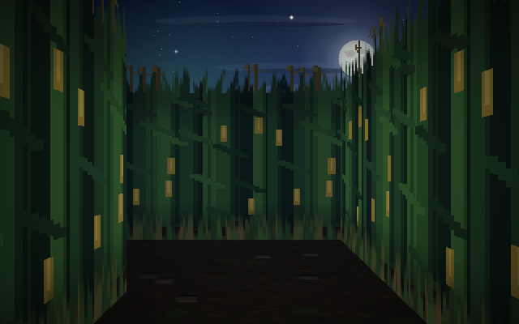
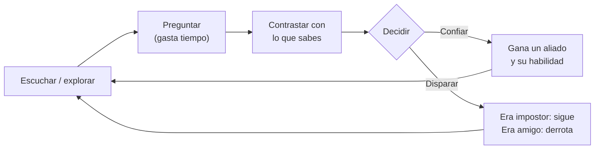
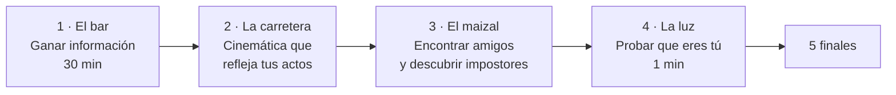
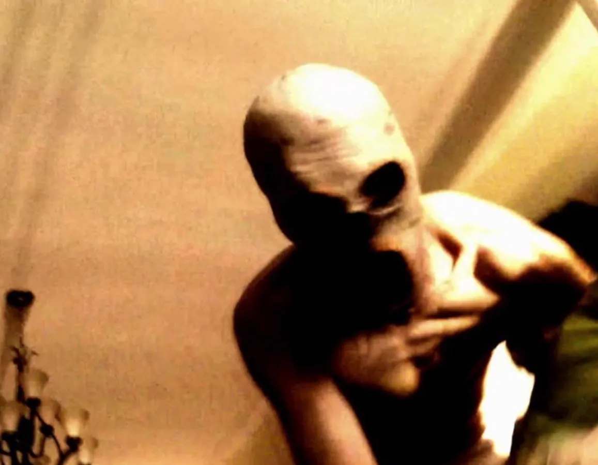
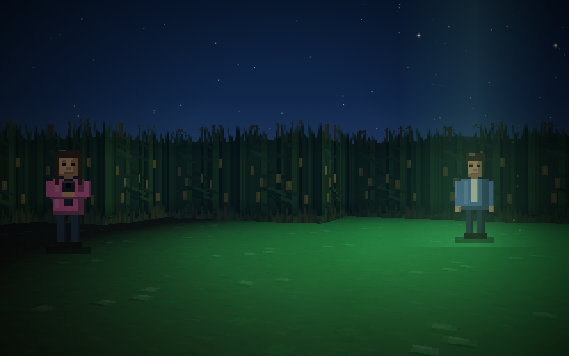
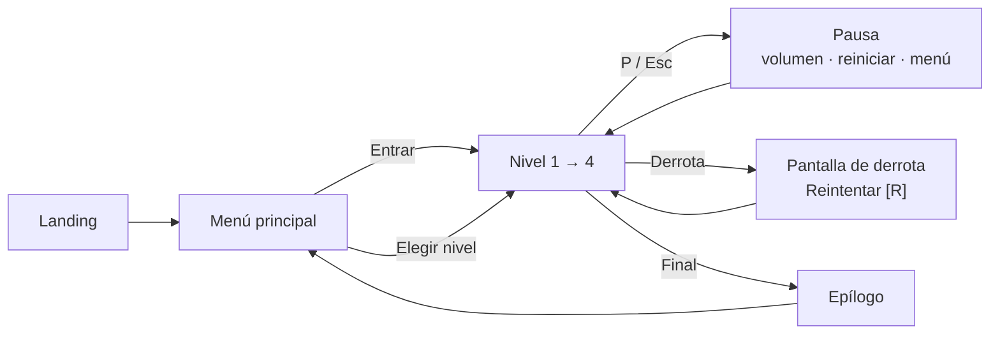

# Hay algo en el maizal — Game Design Document



> Versión 1.0 · 21 de noviembre de 2026 · Documento de producción del prototipo jugable

---

## 1. Portada y ficha técnica

| Campo | Detalle |
|---|---|
| **Título** | Hay algo en el maizal |
| **Integrante y roles** | Gregory Leandro Salazar Domínguez — diseño de juego, narrativa, programación, arte pixel, audio y QA (trabajo individual) |
| **Género** | Terror narrativo en primera persona con deducción social |
| **Plataforma** | Navegador de escritorio (Chrome, Edge, Firefox). Teclado y mouse |
| **Público objetivo** | Mayores de 16 años. Jugadores de terror narrativo y de juegos de deducción (*Among Us*, *Inscryption*, *Papers, Please*) que prefieren pensar antes que disparar. Partidas cortas, de 25 a 40 minutos |
| **Estilo visual** | Pixel art dibujado por código sobre un motor *raycasting* propio (640 × 400), noche azul con luz verde |
| **Ambientación** | Una carretera rural de la Sierra ecuatoriana, de noche: la vía vieja a Baños |

**Elevator pitch**

> *Hay algo en el maizal* es un juego de terror en primera persona donde un joven debe sacar a sus amigos de un maizal mientras algo con sus caras los imita. Lo único que distingue a un amigo de una copia es lo que te contaron a solas en el bar, horas antes, lejos de los oídos equivocados.

---

## 2. Pilares de diseño y experiencia (MDA)

### Tres pilares

| # | Pilar | Qué significa en el juego | Qué queda prohibido |
|---|---|---|---|
| 1 | **Lo que sabes es tu arma** | La única forma de reconocer a un impostor es la información que el jugador ganó antes: los secretos contados a solas en el bar y los hechos del choque. | Adivinar al azar. Cada impostor se puede detectar con información real. |
| 2 | **Decidir bajo presión** | Siempre hay un reloj: 30 minutos en el bar, 45 segundos por conversación en el maizal y 1 minuto en el final. Preguntar más da certeza, pero cuesta tiempo. | Conversaciones sin límite o decisiones sin costo. |
| 3 | **Cada decisión deja huella** | Lo que pasa en un nivel cambia el siguiente: quién maneja, qué dice la radio, quién sale herido, quién llega al final y qué final ves. | Niveles aislados o elecciones que no cambian nada. |

### Del sistema a la emoción

| Mecánica (M) | Dinámica (D) | Estética (A) |
|---|---|---|
| Secretos que solo se cuentan a solas, y un viejo que escucha si está cerca | El jugador busca lugares apartados, desconfía y mide quién lo oye | **Paranoia**, **descubrimiento** |
| Cada pregunta gasta tiempo del reloj | Elegir qué preguntar y cuándo dejar de preguntar | **Tensión**, **desafío** |
| El impostor copia lo que se dijo cerca del viejo, pero no cómo es cada amigo | Contrastar respuestas con personalidades y hechos | **Deducción**, **dominio** |
| Disparar es irreversible: si era un amigo, la partida termina | Dudar, culpa por equivocarse | **Miedo**, **culpa** |
| El alien acelera con cada encuentro y sus pasos suenan más cerca | Avanzar rápido sin perderse | **Terror**, **urgencia** |

**Estética principal:** tensión y miedo sostenidos. **Secundarias:** narrativa (descubrir qué es don Lucho y qué le pasó al papá de Stalin) y desafío de deducción.

---

## 3. Core loop y mecánicas

### Bucle principal (segundo a segundo)



### Bucle de la partida (minuto a minuto)



Lo que el jugador obtiene en el bar (secretos, perdones, pistas) es lo que usa en el maizal y en el final. La carretera no tiene decisiones: muestra las consecuencias del bar y fija quién maneja, quién va de copiloto y quién sale herido.

### Mecánicas principales

| Mecánica | Input | Regla | Feedback al jugador |
|---|---|---|---|
| **Caminar y mirar** | W A S D / mouse | 3,1 casillas/s en el maizal. El maíz es pared; el alien lo atraviesa. | Balanceo de cámara al caminar, pasos en el maíz. |
| **Hablar** | E (de cerca y de frente) | Abre el cuadro de diálogo con retrato del personaje. | Aviso «[E] Hablar con …» abajo al centro. |
| **Elegir una respuesta** | 1–6 o clic | Cada opción del bar muestra su costo (1–3 min). Una vez elegida, desaparece de la lista. | El reloj se sacude, suena un tic y aparece «−2 min» en rojo. |
| **Secreto a solas** | Diálogo | Un amigo cuenta su secreto solo si confía en ti y en un lugar apartado (patio o pasillo). | Entra en «Lo que sabes» (J). |
| **Don Lucho escucha** | Pasivo | Si don Lucho está a menos de 3,2 casillas cuando oyes un secreto, el alien también lo sabrá. | La radio chisporrotea, el viejo deja la cuchara, la música se corta. |
| **Examinar pistas** | E sobre objetos | Nueve pistas (cartel, calendario, radio, baño…) revelan quién es don Lucho. | Texto de la pista y entrada en «Lo que sabes». |
| **Preguntar en el maizal** | 1–6 | 45 s para decidir. Cada pregunta resta 2 s. Preguntas: quién manejaba, quién iba adelante, quién se lastimó y, si conoces su secreto, una pregunta privada. | Anillo «esa cosa llega en» que late y cambia a naranja (≤ 12 s) y rojo (≤ 5 s). |
| **Confiar** | «Ven conmigo» | Si era real, se une y da su habilidad. Si era impostor, derrota. | Tarjeta «X se une» con su habilidad. |
| **Disparar** | «Tú no eres X» | Si era impostor, se transforma y huye. Si era real, derrota. | Retroceso del arma, grito, transformación. |
| **Dar paz** | «Perdóname» | Un amigo ya alcanzado pide que acabes con él. Negarte acelera al alien. | Silencio; el amigo queda tachado en el HUD. |
| **Ecolocalización** | Pasivo | Las voces del maizal suenan desde su posición. | Anillos en pantalla y una flecha si la voz viene de fuera de la vista. |
| **Habilidades de amigos** | Pasivo al unirse | **Paul:** te salva una vez del alien. **Samira:** revela un tramo del camino. **Stalin:** muestra al alien en el mapa. **Sebas:** marca a alguien cercano en el mapa, o presta la habilidad de un amigo perdido. | Mensaje al unirse y cambios en el minimapa. |
| **Interrogatorio final** | A/D o mouse (giro a puntos fijos) + E | No puedes caminar. Cada amigo te pregunta algo; respondes con lo que viviste, con algo público o inventas. | Retrato del otro Pepe que titila con ojos de alien. |

### Victoria y derrota

| Nivel | Victoria | Derrota | Qué pasa al fallar |
|---|---|---|---|
| 1 · El bar | No se pierde. A las 00:00 la noche termina con lo que lograste. | — | Saber poco hace más difícil el maizal y el final. |
| 3 · El maizal | Llegar a la luz verde con todos los encuentros resueltos. | **Te atrapó** (el alien te alcanza o se acaba el tiempo). **Era un amigo** (disparaste a uno real). **Te engañó** (confiaste en un impostor). | Pantalla de derrota con «Reintentar [R]»: el nivel vuelve a empezar. |
| 4 · La luz | El amigo con el arma dispara al otro Pepe. | Te dispara a ti. | Final malo; puedes repetir el final. |

**Los cinco finales:** *Amanecer* (salen todos), *La luz se llevó a Stalin*, *Solo* (llegaste sin amigos y disparaste), *Eligieron al otro Pepe* y *Nadie notó la diferencia*.

---

## 4. Narrativa, mundo y personajes

### Premisa

Viernes 13 de noviembre, cumpleaños de Stalin. Cinco amigos que hace un año eran inseparables paran en un bar de carretera de la vía vieja a Baños antes de seguir de viaje. Pepe faltó al funeral de la abuela de Paul y desde entonces casi no se hablan. Paul se va a medianoche: hay media hora para arreglar las cosas.

En la barra, un viejo de poncho rojo, don Lucho, no les quita la vista. No come y no pestañea. Hace quince años, en esa misma vía y en otro cumpleaños, desapareció Rafael, el papá de Stalin. Esa noche una luz verde baja del cerro, persigue la camioneta y la saca del camino. Pepe despierta en un maizal donde algo copia las caras y las voces de sus amigos, y solo sabe lo que se dijo cerca de don Lucho.

### Personajes

| Personaje | Rol | Motivación | Comportamiento en el juego |
|---|---|---|---|
| **Pepe** | Protagonista (el jugador) | Recuperar a sus amigos y su lugar en el grupo | Lleva la pistola de su papá. Solo él decide en quién confiar. |
| **Paul** | Amigo herido emocionalmente | Se va a España el 3 de diciembre; no perdona a Pepe | Bebe: arrastra las palabras. Si lo salvas, se lanza una vez contra el alien. |
| **Samira** | Amiga a la defensiva | Terminó con Sebas porque apuesta y le mintió | Responde a la defensiva. Revela un tramo del camino. Puede espantarse y huir. |
| **Sebas** | El chistoso inseguro | Perdió su trabajo y no lo ha dicho | Duda de todo. Marca a alguien en el mapa. Si el reloj llega a 0 a su lado, te quita la pistola y dispara. |
| **Stalin** | El cumpleañero | Busca a su papá desde hace 15 años | Habla de luces y abducciones. Siente al alien: lo muestra en el mapa. En el final, la cosa usa la cara de su papá para llevárselo. |
| **Don Lucho / el alien** | Antagonista | Llevarse a alguien cada 13 de noviembre | En el bar escucha a 3,2 casillas. En el maizal persigue: en línea recta si estás a menos de 7 casillas; si no, rastrea puntos cercanos a ti. Velocidad 0,5 casillas/s, +0,08 por cada encuentro resuelto. Atrapa a 0,55 casillas. |
| **Impostores (2)** | Enemigos disfrazados | Que los lleves con vida hasta la luz | Repiten palabra por palabra lo que oyó don Lucho. Fallan 1 o 2 hechos del choque. Nunca dicen «no sé». Se delatan con detalles: no parpadean, sonríen un segundo tarde, ni un rasguño. |
| **El otro Pepe** | Jefe final | Ocupar tu lugar | Tiene tu cara y responde sin dudar. Si no sabe algo, finge que sí. |
| **Doña Carmen** | NPC del bar | Atender su negocio | Da pistas sobre don Lucho. |

---

## 5. Diseño de niveles y progresión

| Nivel | Objetivo | Mecánica nueva | Reto y dificultad |
|---|---|---|---|
| **1 · El bar** (tutorial) | Hablar con todos en 30 minutos y ganarse sus secretos | Caminar, hablar, opciones con costo de tiempo, pistas, «Lo que sabes» | Bajo. No se pierde, pero el tiempo no alcanza para todo y don Lucho puede escuchar. |
| **2 · La carretera** | Ver la persecución | Ninguna: cinemática que cambia según el bar | Sin dificultad. Ritmo y tensión. |
| **3 · El maizal** | Encontrar a 4 amigos entre 2 impostores y llegar a la luz verde | Preguntar con reloj de 45 s, disparar o confiar, minimapa, habilidades, ecolocalización | Alta y creciente. El alien acelera con cada encuentro; los impostores aparecen entre los reales. |
| **4 · La luz** | Probar ante tus amigos que eres el Pepe real en 1 minuto | Giro a puntos fijos, respuestas vividas frente a públicas, confesar lo que contaste | Máxima. No hay movimiento; un error con información pública te condena. |

**Curva de dificultad:** el bar enseña los sistemas sin castigo; la carretera da una pausa; el maizal pone el reloj y la persecución a la vez; el final quita el movimiento y deja solo la información.

### Mapa del maizal (greybox)

Mapa real del nivel 3 (38 × 23 casillas). La salida está al sureste; el camino correcto se calcula solo de P a X.

```text
######################################
#ooo#...........#.............########     P  inicio de Pepe (camioneta volcada)
#ooo#.#########.###.#########.########     o  claro del choque (zona segura)
#ooP#...............#.......#.########     .  camino entre el maíz
###.###.#####.#######.#####.#.########     #  maíz: pared para Pepe, no para el alien
#.#...#.....#...#.....#...#.#.########     F  maíz seco bajo del borde
#.###.#######.#.#####.#.#.#.#.########     =  camino de tierra hacia la salida
#...#...#...#.#.#.....#.#.#.#.########     X  la luz verde (meta)
#.#.###.#.#.###.#.#.###.#.#.#.########
#.#...#...#.....#.#.#...#.....########     Encuentros: 6 personas (4 amigos y
#.##.##.#.#######.###.#####.#.########     2 impostores) aparecen en casillas a
#.#...#.........#...#.#...#.#.########     2 o más pasos, cada 9 s tras un amigo
#.#.#.#.###.#####.#.#.###.#.#.########     y cada 16 s tras un impostor.
#...#.....#.#.....#.#...#.#...########
#######.###.#.#####.###.#.#.#.########     Alien: empieza lejos y patrulla.
#.......#...#.#...#...#...#.#.########     Latidos a < 6 casillas,
#.#####.#.#.#.###.#.#####.#.##########     pasos a < 9 casillas.
#...#.....#.#.....#.......#...########
###.#######.#####.#######.###.########     Stalin (el real) espera cerca de la luz.
#...#...#...#...#.#...#.......########
#.###.#.#.#.#.#.#.#.#.#.#####.FFFFFFFF
#.....#...#...#.........#####.======XF
##############################FFFFFFFF
```

### Mapa del bar (nivel 1)

```text
#BBBB###     B estantería · C barra (doña Carmen y don Lucho)
#....###     X salida · V ventana · S neón
#CCC...X     G guitarra · P cartel de «Se busca» · L calendario
G......V     D pizarra · H perchero
P......S     , pasillo (lugar apartado) · K baño
H......#     _ patio (lugar apartado) · F cerca baja
#,#D;#L#     A paredes de adobe · O campo abierto
#,#A__A#
#,#A__A#     Salón: don Lucho escucha (3,2 casillas)
#,#A__A#     Pasillo y patio: los secretos están a salvo
#K#FFFF#
###OOOO#
```

---

## 6. Dirección de arte, audio y UI/UX

### Arte

**Estilo:** pixel art en baja resolución (640 × 400, columnas de 2 px) dibujado por código, sin archivos de sprites. Motor *raycasting* con niebla nocturna: a 8 casillas la noche se traga todo.

| Color | Hex | Uso |
|---|---|---|
| Noche | `#04070C` | Fondo, cielo, menús |
| Luz de la nave | `#B9F66D` | Acento, títulos, botón principal |
| Verde alien | `#6DFF9A` | Luz verde, ecolocalización, salida |
| Ojos / peligro | `#FF5B68` | Ojos rojos, reloj en peligro, derrota |
| Bombillas del bar | `#FFE08A` | Calidez del bar, avisos |

**Moodboard:**

| Referencia del alien | Referencia del alien | Resultado en el juego |
|---|---|---|
|  |  |  |
| Cabeza sin pelo, ojos y boca negros, estética de video casero | Movimiento brusco y borroso | El claro del nivel 4 bajo la luz verde |

**Tipografía:** Silkscreen (pixel) para títulos y etiquetas; Atkinson Hyperlegible para diálogos y números, por legibilidad.

### Audio

**Música (BGM):**

| Pista | Dónde | Tratamiento |
|---|---|---|
| Música del bar | Nivel 1 | Sale de la rocola: suena lejos, con estática, y se corta cerca de don Lucho |
| Música del maizal | Menú (desde el minuto 5), niveles 3 y 4 | Ambiente oscuro en loop |

**Efectos clave (SFX)**, generados con Web Audio:

| Evento | Sonido |
|---|---|
| Disparo | Golpe seco con eco |
| Alien cerca | Pasos pesados con paneo, latidos y gruñido |
| Impostor descubierto | Grito y transformación |
| Reloj | Tic en los últimos 5 segundos y al gastar tiempo |
| Victoria | Campanada al amanecer |
| Maíz | Crujidos, ramas, susurros, risas y viento cerca de la salida |
| Nave | Zumbido grave con vibración |
| Radio | Estática que repite voces |

### UI y HUD

```text
BAR                                         MAIZAL
┌──────────────────────────────────────┐   ┌──────────────────────────────────────┐
│ (12) Paul se va en     [J] LO QUE    │   │ [■][■][x][■] Amigos salvados: 2/4  ▢ │
│      minutos               SABES     │   │                          minimapa ▢ │
│                                      │   │                                      │
│            vista 3D                  │   │            vista 3D                  │
│                                      │   │                                      │
│        [E] HABLAR CON SAMIRA         │   │   (eco de una voz: anillos/flecha)   │
└──────────────────────────────────────┘   └──────────────────────────────────────┘
En un diálogo: retrato + nombre + texto + opciones numeradas con su costo.
El mismo reloj de anillo se usa en los tres niveles: solo cambian el texto y el número.
```

**Flujo de menús:**



**Controles:** W A S D caminar · mouse mirar · E hablar o examinar · 1–6 responder · Enter o clic continuar · H historial · J lo que sabes · M mapa · Q despedirse (bar) · P o Esc pausa.

**Accesibilidad:** letra legible en diálogos, avisos con color y texto a la vez, y volumen general en la pausa.

---

## 7. Alcance técnico y plan de producción

### Motor y herramientas

| Área | Herramienta |
|---|---|
| Motor | Ninguno: motor *raycasting* propio en JavaScript sobre Canvas 2D, compartido por el bar, el maizal y el final |
| Audio | Web Audio API (efectos sintetizados y mezcla); música en Opus (.ogg) con copia MP3 para Safari |
| Arte | Sprites y texturas generados por código; capturas del juego en WebP sin pérdida |
| Edición | Visual Studio Code y Claude Code |
| Medios | FFmpeg (compresión de audio a Opus y de imágenes a WebP) |
| Pruebas | Chrome sin interfaz con scripts de recorrido de niveles |
| Repositorio | Git y GitHub |

**Arquitectura:** `game.js` (motor, bar, maizal, UI, audio), `chase.js` (cinemática), `final.js` (nivel 4), `game.html` (sistema de diseño) e `index.html` (landing). Peso del juego: unos 11 MB, casi todo música (Opus + copia MP3).

### Matriz MoSCoW

| Prioridad | Elemento | Estado |
|---|---|---|
| **Must have** | Motor en primera persona con colisiones | Hecho |
| | Sistema de diálogo único para todos los niveles | Hecho |
| | Bar con secretos, pistas y reloj de 30 minutos | Hecho |
| | Maizal con impostores, reloj de 45 s y alien que persigue | Hecho |
| | Final con interrogatorio y al menos un final bueno y uno malo | Hecho (5 finales) |
| | Victoria, derrota y reintento en cada nivel | Hecho |
| **Should have** | Cinemática de la carretera que cambia según el bar | Hecho |
| | Habilidades distintas por amigo | Hecho |
| | Música, efectos y ecolocalización de voces | Hecho |
| | Menú de pausa con volumen y selección de nivel | Hecho |
| | Landing con clasificación 16+ y política de privacidad | Hecho |
| | Sensibilidad del mouse configurable | Pendiente |
| **Could have** | Guardar la partida entre sesiones | Pendiente (hoy se usa «Elegir nivel») |
| | Subtítulos de efectos de sonido | Pendiente |
| **Won't have** (esta versión) | Controles táctiles y versión móvil | Fuera de alcance |
| | Control con mando | Fuera de alcance |
| | Voces grabadas | Fuera de alcance |
| | Traducción a otros idiomas | Fuera de alcance |
| | Multijugador | Fuera de alcance |

**Riesgo principal y mitigación:** el navegador bloquea el sonido hasta el primer gesto del jugador. La música intenta sonar al abrir y, si se bloquea, arranca con el primer clic o tecla. Entrar desde la landing cuenta como gesto.
