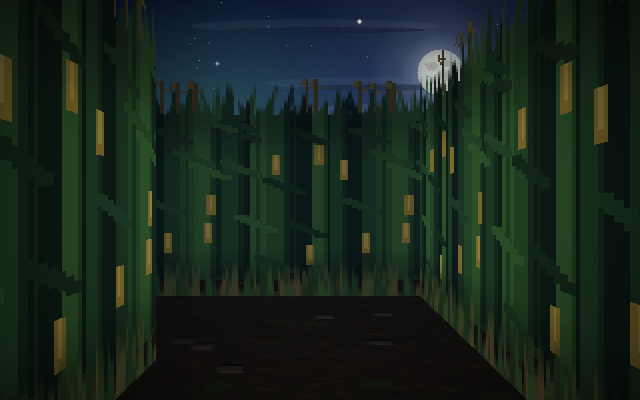

# Hay algo en el maizal



Terror narrativo en primera persona para el navegador. Una noche, cuatro amigos y algo que copia sus caras: solo lo que te contaron a solas te dirá quién es quién.

**Documento de diseño completo: [GDD.md](GDD.md)** · [versión PDF](GDD.pdf)

| | |
|---|---|
| **Género** | Terror narrativo con deducción |
| **Plataforma** | Navegador de escritorio, teclado y mouse |
| **Edad** | 16+ (terror, violencia con armas, sangre, alcohol, apuestas) |
| **Duración** | 25 a 40 minutos · 4 niveles · 5 finales |
| **Tecnología** | JavaScript puro, Canvas 2D y Web Audio. Sin motor ni dependencias |

## Cómo jugar

1. Clona o descarga el repositorio.
2. Abre `index.html` (la landing) o `game.html` (el juego directo) en Chrome, Edge o Firefox.

Funciona abriendo el archivo directamente. Para escuchar la mezcla de audio completa (la música que suena lejos o tras una pared), sírvelo con un servidor local:

```bash
python -m http.server 8000
# luego abre http://localhost:8000
```

No necesita internet: las fuentes, imágenes y música están en el repositorio.

## Controles

| Tecla | Acción |
|---|---|
| W A S D | Caminar |
| Mouse | Mirar (haz clic en el juego para capturarlo) |
| E | Hablar o examinar |
| 1 – 6 | Elegir una respuesta |
| Enter / clic | Continuar el diálogo |
| H | Historial de lo que se dijo |
| J | Lo que sabes |
| M | Minimapa (maizal) |
| Q | Despedirse (bar) |
| P / Esc | Pausa |

## Los niveles

1. **El bar.** Tienes 30 minutos antes de medianoche. Habla con todos: lo que te cuenten a solas te salvará. Cuidado con el viejo de la barra.
2. **La carretera.** Una luz verde persigue a la camioneta. Lo que pasó en el bar decide cómo termina.
3. **El maizal.** Encuentra a tus amigos entre el maíz. Dos de ellos no lo son. Tienes 45 segundos por conversación.
4. **La luz.** Hay dos Pepes. Tus amigos tienen un minuto para decidir a quién disparar.

## Archivos

| Archivo | Contenido |
|---|---|
| `index.html` | Landing page |
| `game.html` | Página del juego y sistema de diseño (tipografías, colores, componentes) |
| `game.js` | Motor *raycasting*, bar, maizal, diálogos, HUD, audio y menús |
| `chase.js` | Nivel 2: la cinemática de la carretera |
| `final.js` | Nivel 4: el interrogatorio final |
| `audio/` | Música en Opus (.ogg) con copia MP3 para Safari |
| `img/` | Capturas del juego, sprites e íconos (WebP) |
| `fonts/` | Silkscreen y Atkinson Hyperlegible |
| `GDD.md` / `GDD.pdf` | Game Design Document |
| `tools/gdd-pdf.mjs` | Genera `GDD.pdf` desde `GDD.md` |

## Privacidad

El juego no recoge datos, no usa cookies ni analítica. Solo guarda el volumen elegido en tu navegador (`maizal.vol`). La política completa está en la landing.

## Autor

Gregory Leandro Salazar Domínguez — diseño, programación, arte, audio y narrativa.
